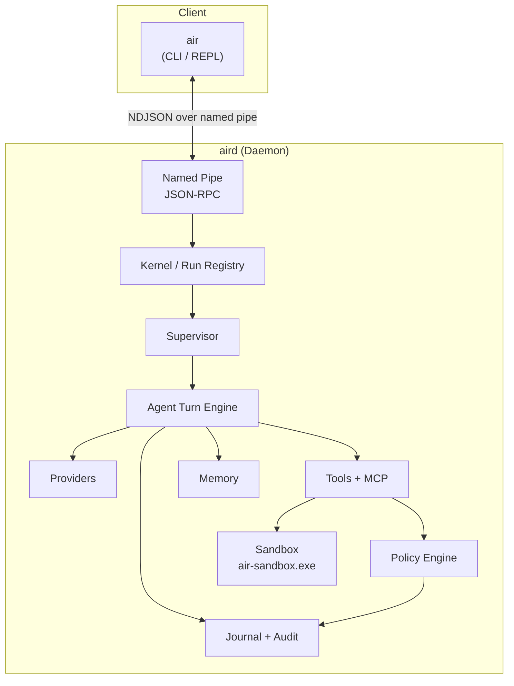

<div align="center">

# AIR — AI Runtime

**Production-grade, AI-native agent runtime and shell for Windows**

[](https://nodejs.org/)
[](https://www.typescriptlang.org/)
[](#)
[](#)
[](#)
[](#status)

<br/>

**Event-sourced • Deny-by-default policy • OS-level sandboxing • Full audit trail**

[Architecture](#architecture) · [Features](#key-features) · [Status](#status) · [Quick Start](#quick-start) · [Security](#security-model) · [Docs](#documentation)

</div>

---

## What is AIR?

AIR is a long-running **daemon** (`aird`) + interactive **shell** (`air`) that treats LLM-driven agents as first-class supervised processes on Windows.

It sits between “an LLM API” and “something you can actually trust to run unattended”:

- Every action is an **event** in an append-only journal
- Every tool call passes through a **deny-by-default policy engine**
- Process execution is contained by **Windows Job Objects** + restricted tokens
- State is recoverable, replayable, and fully auditable

> Operating systems manage *processes*.  
> **AIR manages agents.**

---

## Key Features

<table>
<tr>
<td width="50%">

### 🔒 Security-First Kernel
- Deny-by-default policy with capability model
- Taint tracking + escalation to human approval
- Path canonicalization that understands Windows (junctions, ADS, 8.3, UNC, device names)
- Native sandbox via Job Objects + restricted token
- Hash-chained audit log

</td>
<td width="50%">

### 📓 Event-Sourced Core
- Append-only JSONL journal + SQLite index
- Crash recovery with torn-write detection
- Deterministic replay of any run
- Write-ahead rule for tool calls
- Full correlation IDs across logs & events

</td>
</tr>
<tr>
<td width="50%">

### 🧠 Agent Runtime
- Provider-agnostic (Anthropic, OpenAI-compatible, Ollama)
- Streaming tool-call assembly
- Budgets (tokens, USD, steps, wall-clock)
- Stall / loop detection
- Sub-agent supervisor with inherited budgets

</td>
<td width="50%">

### 🪟 Windows-Native
- Named-pipe IPC with user-SID ACL
- Credential Manager for secrets
- PowerShell-first tooling
- Runtime data under `%LOCALAPPDATA%\AIR`
- Designed for Windows Service packaging

</td>
</tr>
</table>

---

## Why AIR?

Most agent frameworks help you **write** agents.

AIR is designed to help you **run** them safely.

LangGraph gives you powerful stateful graphs and durable execution. CrewAI gives you fast role-based multi-agent collaboration.

Both are excellent at orchestration. Isolation, policy enforcement, and auditability still require careful implementation and configuration for your deployment.

AIR takes a different approach:

- It is a **Windows-native runtime**, not just a library.
- Agents are designed to run with OS-level isolation, including Windows Job Objects and restricted execution boundaries.
- Every action is governed by a **deny-by-default policy engine** with taint tracking.
- The **event-sourced journal** is the source of truth, supporting crash recovery, replay, and a full audit trail.
- Secrets are kept out of tool processes where supported by the credential and execution boundaries. Network egress controls and human approvals are part of the security model.

**In short:**

| If you need… | Prefer |
| --- | --- |
| Complex workflows and branching | LangGraph |
| Fast multi-agent role collaboration | CrewAI |
| Agents that can use real tools on Windows with runtime-enforced isolation, policy, and audit | **AIR** |

AIR is for people who want agents they can leave running with confidence that execution is constrained by the boundaries they define.

---

### Comparison at a Glance

| Dimension | AIR | LangGraph | CrewAI |
| --- | --- | --- | --- |
| **Primary focus** | Secure agent runtime on Windows | Stateful graph orchestration | Role-based multi-agent crews |
| **Platform** | Windows-first | Cross-platform | Cross-platform |
| **Isolation model** | OS-level process containment; Windows Job Objects and restricted execution boundaries | Application-level orchestration; isolation depends on deployment | Application-level orchestration; isolation depends on deployment |
| **Policy** | Deny-by-default policy and taint tracking | Application-defined | Application-defined |
| **Audit and recovery** | Event-sourced journal, integrity checks, and replay | Checkpointing and optional LangSmith observability | Depends on configured persistence and observability |
| **Human approval** | First-class policy decision path | Supported through interrupts and application logic | Supported through task/workflow design and application logic |
| **Local models** | Ollama and OpenAI-compatible providers | Supported through integrations | Supported through integrations |
| **Best for** | Constrained, auditable agents using real Windows tools | Complex, long-running workflows | Rapid multi-agent collaboration and prototyping |

> **Positioning note:** AIR complements orchestration frameworks. LangGraph or CrewAI can coordinate workflow logic while AIR provides a runtime boundary for executing agent actions on Windows.

---

## Architecture



**Layered modules** (enforced by `dependency-cruiser`):

| Layer | Modules |
|-------|---------|
| 8 | `service`, `shell` |
| 7 | `ipc` |
| 6 | `kernel` |
| 5 | `agent` |
| 4 | `tools`, `mcp` |
| 3 | `policy`, `sandbox`, `providers`, `memory` |
| 2 | `journal` |
| 1 | `config`, `secrets`, `observability` |
| 0 | `types`, `errors`, `util` |

---

## Status

| Item | Value |
|------|-------|
| **Current Phase** | P9 — Daemon, IPC, Shell |
| **Overall Progress** | **77 / 94 tasks** (~82%) |
| **Last `npm run check`** | PASS (typecheck + lint + deps + 1511 tests) |
| **Coverage Gates** | Enforced (≥85% global, higher on critical modules) |
| **Next Up** | MCP client (P10-T01) |

<details>
<summary><strong>Phase Progress Overview</strong></summary>

| Phase | Name | Status |
|-------|------|--------|
| P0 | Foundations & scaffolding | ✅ Complete |
| P1 | Core types, errors, config, logging | ✅ Complete |
| P2 | Journal & event bus | ✅ Complete |
| P3 | Provider layer | ✅ Complete |
| P4 | Tool system & built-ins | ✅ Complete |
| P5 | Policy, approvals, budgets, taint | ✅ Complete |
| P6 | Agent loop (turn engine) | ✅ Complete |
| P7 | Sandbox & Windows isolation | ✅ Complete |
| P8 | Memory | ✅ Complete |
| P9 | Daemon, IPC, shell | 🟡 Nearly complete |
| P10 | MCP client | ⬜ Next |
| P11–P12 | Packaging, polish, service | ⬜ Upcoming |

</details>

---

## Quick Start

> **Requirements**: Windows 10/11 · Node.js 22 LTS · PowerShell

```powershell
# Clone
git clone https://github.com/dperry713/AI_runtime.git
cd AI_runtime

# Bootstrap (installs deps, creates AIR_HOME, runs checks)
.\scripts\bootstrap.ps1

# Verify everything is green
npm run check

# Run the development harness (mock provider)
npm run dev:run -- <agent> "<goal>"
```

Runtime data lives in `%LOCALAPPDATA%\AIR` (never inside the synced repo).

---

## Core Concepts

| Term | Definition |
|------|------------|
| **Agent** | Static definition (manifest): system prompt, model, allowed tools, policy profile, budgets |
| **Run** | One execution of an agent toward a goal. Has `RunId`, state machine, journal stream |
| **Turn** | One model invocation + the tool calls it requests and their results |
| **Tool** | Typed, schema-validated capability (`fs.read`, `exec.run`, `http.fetch`, …) |
| **Policy** | Declarative rules → `allow` / `deny` / `ask`. Default is **deny** |
| **Journal** | Append-only, checksummed event log. Source of truth for all state |
| **Taint** | Provenance flag on data from untrusted sources (web, files, tool output) |
| **Sandbox** | OS-level containment (Job Object + restricted token + cwd jail) |

---

## Security Model

AIR assumes the model is **untrusted**. Every tool call is mediated.

**Key guarantees (testable):**

- **S1** Deny by default — empty policy blocks everything
- **S2** 100% of tool executions are preceded by a journaled policy decision
- **S3** No secret ever appears in logs, journal, or model-visible errors
- **S4** Filesystem tools cannot escape granted roots (junctions, ADS, short names, etc.)
- **S5** Sandboxed process trees are fully terminated on timeout/cancel/crash
- **S9** Tainted data cannot reach medium+ risk tools without approval (or denial in headless mode)

Full threat model and requirements live in [`SECURITY.md`](SECURITY.md).

---

## Documentation

| Document | Purpose |
|----------|---------|
| [`AGENTS.md`](AGENTS.md) | **Start here** — mandatory reading for any contributor or agent |
| [`docs/PROJECT.md`](docs/PROJECT.md) | Vision, concepts, glossary, non-goals |
| [`docs/ARCHITECTURE.md`](docs/ARCHITECTURE.md) | Modules, layers, event model, state machines |
| [`docs/BUILD_PLAN.md`](docs/BUILD_PLAN.md) | Phase-by-phase plan with exit criteria |
| [`BUILD_STATUS.md`](BUILD_STATUS.md) | Living progress tracker (source of truth) |
| [`SECURITY.md`](SECURITY.md) | Threat model + security requirements |
| [`docs/TESTING.md`](docs/TESTING.md) | Test strategy and suites |

---

## Development Commands

```powershell
npm run check          # typecheck + lint + dependency rules + tests  (must be green)
npm run typecheck
npm run lint
npm run deps:check     # layer boundary enforcement
npm test               # unit + integration
npm run test:security
npm run test:chaos
npm run test:coverage  # enforces thresholds
```

---

## Design Principles

1. **Safety over convenience** — when unsure, deny or ask
2. **If it isn’t journaled, it didn’t happen**
3. **Determinism where possible** — inject time, randomness, and IDs
4. **Observability is a feature** — logs and metrics ship with the code
5. **Boundaries are enforced by tooling**, not good intentions
6. **Windows is the real target** — model its quirks explicitly
7. **Untrusted by default** — model output, tool output, files, web, MCP, plugins
8. **Every claim needs a test**

---

<div align="center">

**AIR is under active development.**  
Phases 0–8 complete. Phase 9 (Daemon + IPC + Shell) nearly finished.

<br/>

*Built for people who want agents they can actually trust on a Windows machine.*

</div>
